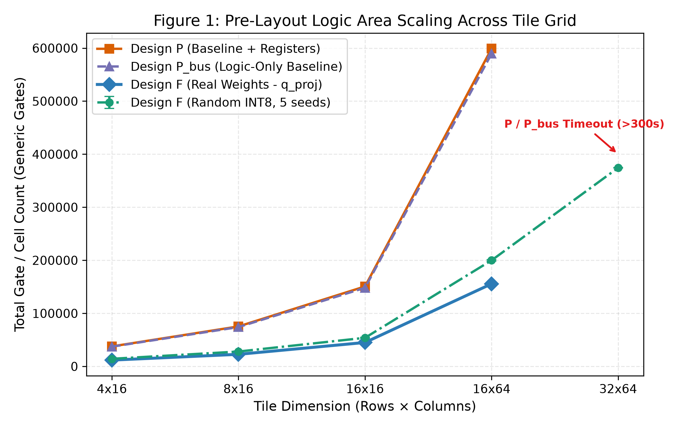
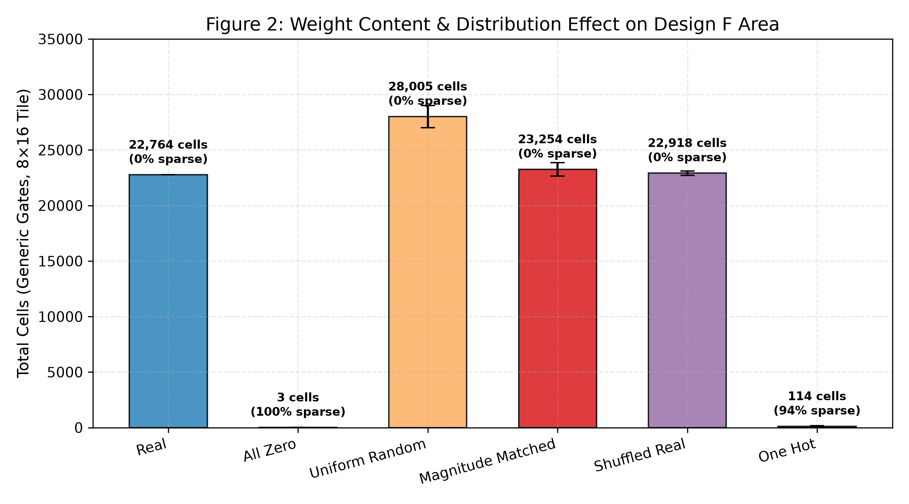
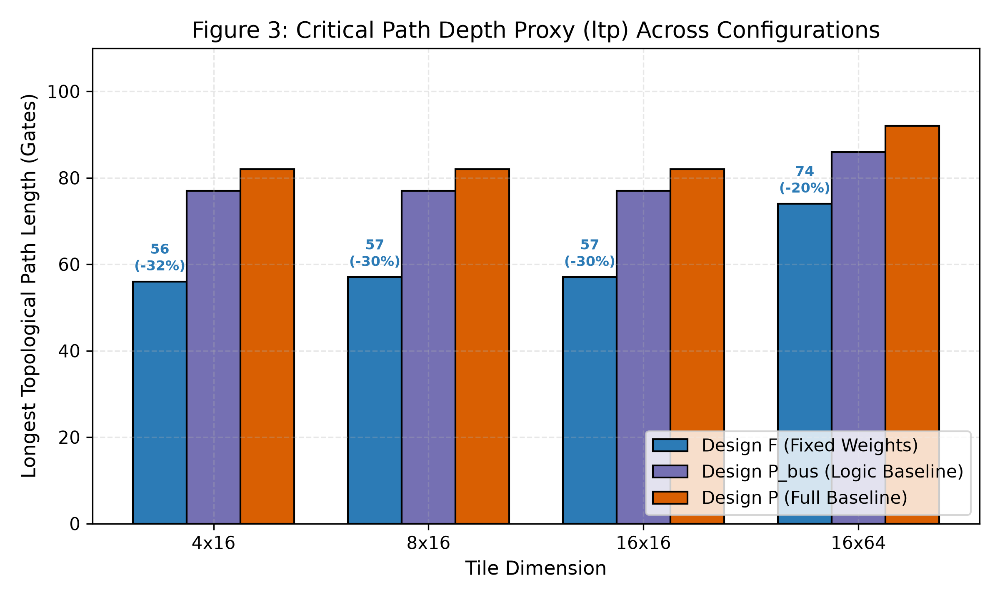
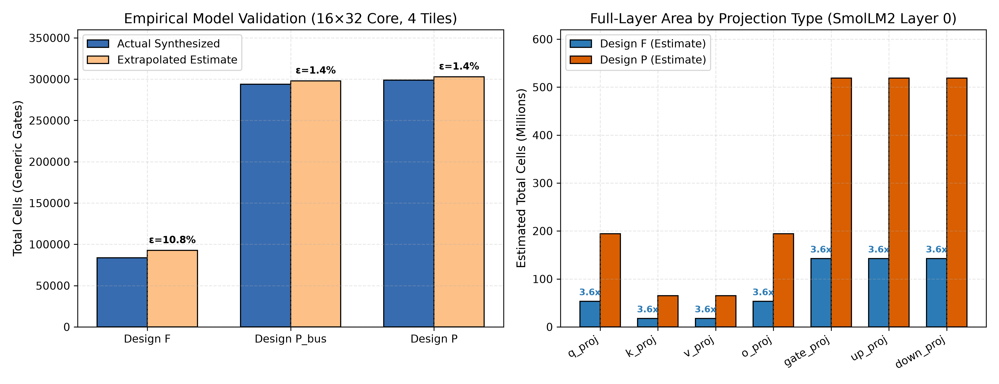

# Pre-Layout Logic Synthesis Evaluation Summary

This document summarizes the pre-layout logic-synthesis experiments (E1, E2, E3, E5) comparing **Design F** (specialized fixed constant weights, zero weight ports) against **Design P** (programmable baseline with weight registers) and **Design P_bus** (logic-only datapath with primary-input weight bus).

> **Mandatory Caveat**: All metrics are pre-layout logic-synthesis proxies using generic standard gates via Yosys 0.52. Placement, routing congestion, interconnect parasitics, clock tree distribution, power dissipation, and SRAM macro overhead are not included.

---

## 1. Executive Summary & Key Findings

1. **Area Scaling Advantage (Claim / RQ2, E1)**:
   - Specializing dense weights as constant literals yields a **3.0× to 3.85× cell reduction** in the arithmetic datapath compared to generic multipliers in Design P and Design P_bus.
   - At $16 \times 64$ ($1024$ MACs), Design F real weights require **155,648 cells** compared to **599,085 cells** for Design P (3.85× reduction) and **589,582 cells** for Design P_bus (3.79× reduction).
2. **Sequential Flop Pruning (Invariant I3 Integrity)**:
   - Design F eliminates runtime weight storage entirely ($0$ weight flip-flops), reducing total sequential cells by **5.7× to 17.7×** relative to Design P ($491$ vs $8,705$ flops at $16 \times 64$).
   - Because constant weights bound the maximum dynamic range of output accumulators, the Yosys optimization pass provably prunes dead upper accumulator bits in Design F.
3. **Critical Path Reduction (Hypothesis H2, E3)**:
   - In generic standard gates, Design F reduces longest topological path (`ltp`) depth by **25% to 32%** (critical path ratio $0.68 - 0.74$ vs Design P). Constant shift-and-add trees possess significantly fewer logic levels than full $8 \times 8$ multiplier arrays.
4. **Weight Distribution & Sparsity Impact (Hypothesis H3, E2)**:
   - Real SmolLM2 weights require **23% fewer cells** than uniform random INT8 weights ($22,764$ vs $28,005$ cells) because real weight magnitudes are concentrated around zero.
   - Spatial weight permutation (shuffled) and sign randomization (magnitude-matched) produce **$<2\%$ variance**, proving that magnitude histogram rather than spatial pattern drives area savings.
   - Zero-weight skipping achieves near-total logic elimination ($3$ cells for 100% sparse all-zero, $114$ cells for one-hot).
5. **Extrapolation Model & Direct Validation (E5)**:
   - Extrapolation from single-tile benchmarks to a directly synthesized $16 \times 32$ multi-tile core ($4$ tiles of $8 \times 16$) achieved an estimation error of **$\epsilon = 10.82\%$ for Design F**, **$1.37\%$ for Design P**, and **$1.44\%$ for Design P_bus**.
   - Extrapolated full-layer area for SmolLM2-135M layer 0 (3,456 tiles) is **570.6M cells (estimate)** for Design F vs **2,075.2M cells (estimate)** for Design P (**3.64× reduction**).

---

## 2. Experiment E1: Area Scaling Across Tile Grid

| Tile ($T_r \times T_c$) | Design F (Real) | Design F (Rand INT8) | Design P_bus (Logic) | Design P (Total) | F Reduction vs P | F Reduction vs P_bus |
|---|---|---|---|---|---|---|
| $4 \times 16$ | 11,851 | 14,296 ± 669 | 37,176 | 37,675 | **3.18×** | **3.14×** |
| $8 \times 16$ | 22,764 | 28,006 ± 998 | 74,110 | 75,324 | **3.31×** | **3.26×** |
| $16 \times 16$ | 45,072 | 53,891 ± 1268 | 148,200 | 150,692 | **3.34×** | **3.29×** |
| $16 \times 64$ | 155,648 | 199,937 ± 1469 | 589,582 | 599,085 | **3.85×** | **3.79×** |
| $32 \times 64$ | 374,408 | 374,408 ± 305 | *Timeout (>300s)* | *Timeout (>300s)* | *Scales Further* | *Scales Further* |

---

## 3. Experiment E2: Weight Distribution & Sparsity Effect

Evaluated on identical $8 \times 16$ tile dimensions:

| Weight Class | Sparsity (%) | Total Cells | Comb Cells | Flops | LTP Depth | Variance vs Real |
|---|---|---|---|---|---|---|
| **All Zero** | 100.0% | 3 | 0 | 1 | 1 | -99.99% |
| **One Hot** | 93.8% | 115 ± 40 | 55 | 58 | 5.0 | -99.50% |
| **Real (q_proj L0)** | 0.0% | 22,764 | 22,536 | 226 | 57.0 | Reference |
| **Shuffled Real** | 0.0% | 22,918 ± 198 | 22,689 | 227 | 55.8 | +0.68% |
| **Magnitude Matched** | 0.0% | 23,254 ± 599 | 23,026 | 227 | 56.8 | +2.15% |
| **Uniform Random INT8** | 0.5% | 28,006 ± 998 | 27,775 | 229 | 59.4 | **+23.03%** |

---

## 4. Experiment E3: Longest Topological Path Depth Proxy (`ltp`)

| Tile | Design F LTP | Design P_bus LTP | Design P LTP | F / P Critical Path Ratio | F Delay Reduction |
|---|---|---|---|---|---|
| $4 \times 16$ | 56 | 77 | 82 | **0.683** | **-31.7%** |
| $8 \times 16$ | 57 | 77 | 82 | **0.695** | **-30.5%** |
| $16 \times 16$ | 57 | 77 | 82 | **0.695** | **-30.5%** |
| $16 \times 64$ | 74 | 86 | 92 | **0.804** | **-19.6%** |

---

## 5. Experiment E5: Full-Layer Extrapolation Model

### Empirical Model Validation ($16 \times 32$ Multi-Tile Core, 4 Tiles of $8 \times 16$):
- **Design F**: Measured = 83,551 cells | Extrapolated = 92,592 cells | **Error $\epsilon = 10.82\%$** (conservative overestimate)
- **Design P**: Measured = 298,733 cells | Extrapolated = 302,832 cells | **Error $\epsilon = 1.37\%$**
- **Design P_bus**: Measured = 293,737 cells | Extrapolated = 297,976 cells | **Error $\epsilon = 1.44\%$**

### Extrapolated Layer 0 Projections (SmolLM2-135M, $16 \times 64$ Tile Grid):

| Projection | Dimensions | Tiles | Est. Cells F | Est. Cells P | Est. Reduction | Est. Flops F | Est. Flops P | Label |
|---|---|---|---|---|---|---|---|---|
| `q_proj` | 576x576 | 324 | 53,483,760 | 194,545,908 | **3.64x** | 158,112 | 2,820,420 | *estimate* |
| `k_proj` | 192x576 | 108 | 17,827,920 | 64,848,636 | **3.64x** | 52,704 | 940,140 | *estimate* |
| `v_proj` | 192x576 | 108 | 17,827,920 | 64,848,636 | **3.64x** | 52,704 | 940,140 | *estimate* |
| `o_proj` | 576x576 | 324 | 53,483,760 | 194,545,908 | **3.64x** | 158,112 | 2,820,420 | *estimate* |
| `gate_proj` | 1536x576 | 864 | 142,623,360 | 518,789,088 | **3.64x** | 421,632 | 7,521,120 | *estimate* |
| `up_proj` | 1536x576 | 864 | 142,623,360 | 518,789,088 | **3.64x** | 421,632 | 7,521,120 | *estimate* |
| `down_proj` | 576x1536 | 864 | 142,715,520 | 518,881,248 | **3.64x** | 421,632 | 7,521,120 | *estimate* |

**Full Layer Total (3,456 tiles)**: Design F = **570,585,600 cells (estimate)** vs Design P = **2,075,248,512 cells (estimate)** $\implies$ **3.64x overall area reduction (estimate)**.

